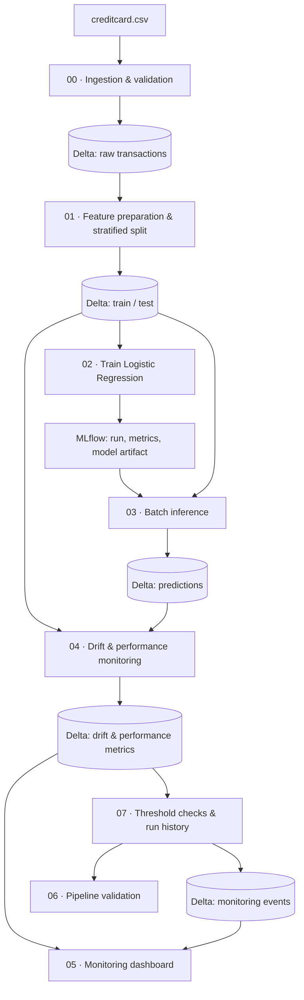

# Credit Card Fraud Detection — End-to-End MLOps

A portfolio project that extends a reproducible credit-card fraud classification baseline into a Databricks-based MLOps workflow. It demonstrates data preparation, MLflow experiment tracking, batch inference, data drift monitoring, model-performance checks, dashboarding, and persistent monitoring alerts.

> **Scope:** This is a learning/portfolio prototype using a public, highly imbalanced benchmark dataset. It is not a production fraud-control system, and model predictions must not be treated as proof of fraud.

## Project highlights

- **Data engineering:** validate transaction data and persist raw, train, test, prediction, and monitoring outputs as Delta tables.
- **Model development:** stratified train/test split and class-weighted Logistic Regression, with scaling fitted within a scikit-learn pipeline.
- **Experiment tracking:** log model parameters, evaluation metrics, and the model artifact with MLflow.
- **Batch inference:** load the model artifact from its MLflow run, score held-out transactions, and persist probabilities and predicted classes.
- **Data drift:** compare reference and current feature distributions using Population Stability Index (PSI) and Kolmogorov–Smirnov (KS) statistics.
- **Model evaluation:** track precision, recall, F1, ROC-AUC, and average precision for labeled evaluation data.
- **Monitoring UI:** visualize model metrics, drift signals, and prediction-score distributions in a notebook dashboard.
- **Alert history:** evaluate configurable thresholds and append monitoring events to a Delta table for review across runs.
- **Version control:** notebooks are stored in `databricks/` and versioned with Git.

## Architecture



## Repository structure

```text
.
├── Fraud Detection.ipynb
├── creditcard.csv
├── src/
│   └── train.py
├── databricks/
│   ├── 00_data_ingestion_validation.ipynb
│   ├── 01_feature_prep_split.ipynb
│   ├── 02_model_training_mlflow.ipynb
│   ├── 03_batch_inference.ipynb
│   ├── 04_drift_performance_monitoring.ipynb
│   ├── 05_monitoring_dashboard.ipynb
│   ├── 06_pipeline_validation.ipynb
│   ├── 07_alerting_and_run_history.ipynb
│   └── README.md
├── requirements.txt
└── README.md
```

## Databricks Free Edition setup

The notebook workflow is designed to use Databricks Free Edition and serverless notebook compute. It does not require a paid model-serving endpoint.

1. Open your Databricks workspace and use a Unity Catalog schema where you have permission to create tables and volumes.
2. Create a volume (for example, `fraud_data`) and upload `creditcard.csv` from this repository through the Databricks UI.
3. In Notebook 00, set `SOURCE_PATH` to the actual volume path:
   `/Volumes/<catalog>/<schema>/fraud_data/creditcard.csv`.
4. Open the notebooks under `databricks/` and run them in the order shown below, using the same catalog and schema.
5. Inspect MLflow runs, Delta tables, dashboard outputs, and monitoring events.

See [Databricks notebook instructions](databricks/README.md) for the table names and execution order. Workspace features and job quotas can vary in Free Edition; confirm availability in your workspace before configuring scheduled runs.

## Notebook execution order

| Notebook | Purpose | Main outputs |
|---|---|---|
| `00_data_ingestion_validation` | Read and validate the source CSV | `fraud_transactions_raw` |
| `01_feature_prep_split` | Validate target, create stratified split | `fraud_transactions_train`, `fraud_transactions_test` |
| `02_model_training_mlflow` | Train baseline and log experiment/model | MLflow run and model artifact |
| `03_batch_inference` | Score test transactions | `fraud_predictions_test` |
| `04_drift_performance_monitoring` | Calculate drift and evaluation metrics | `fraud_drift_normal`, `fraud_drift_simulated`, `fraud_model_performance` |
| `05_monitoring_dashboard` | Visualize metrics, drift, and risk scores | Notebook visualizations |
| `06_pipeline_validation` | Check required output tables | Validation summary |
| `07_alerting_and_run_history` | Apply thresholds and persist check events | `fraud_monitoring_events` |

Notebook 07 also uses `fraud_model_run_registry` to identify the MLflow run for the current model. Run Notebook 02 after adding the registry cell, then run Notebook 03.

## Monitoring approach

- **PSI:** flags a feature when PSI exceeds the configured threshold (default example: 0.20).
- **KS test:** flags distribution differences when the p-value is below the configured threshold (default example: 0.05).
- **Performance checks:** example thresholds are configured for recall and average precision. They should be calibrated to the use case and the cost of false negatives versus false positives.
- **Simulated drift:** Notebook 04 deliberately modifies selected feature distributions to test the detector. Simulated results are validation data, not real production alerts.
- **Delayed labels:** true precision/recall cannot be measured for new transactions until their outcomes are known. Drift alerts alone do not prove model degradation.

Thresholds in the notebooks are illustrative starting points, not universal standards. PSI and KS are signals for investigation rather than automatic evidence that retraining is required.

## Local baseline

The original script-based baseline can be run outside Databricks. Use Python 3.10 or 3.11.

```bash
git clone https://github.com/BharathRoshan/Fraud-Detection.git
cd Fraud-Detection
python -m venv .venv
# macOS/Linux
source .venv/bin/activate
# Windows PowerShell: .venv\\Scripts\\Activate.ps1
pip install -r requirements.txt
python src/train.py --data creditcard.csv --output-dir artifacts
```

The baseline script saves evaluation artifacts locally. The Databricks notebooks are a separate workflow and use Delta tables and MLflow.

## Validation status

The notebook workflow and monitoring outputs were run in Databricks Free Edition, and the pipeline validation notebook was used to check the expected output tables. The repository does not publish fixed metric scores because results depend on the actual run and configuration. Re-run the notebooks in your own workspace to reproduce the outputs.

Before describing this as a production deployment, add a repeatable job run, alert delivery to an external channel, data-quality checks appropriate to the business, access controls, and validation on temporally representative data.

## Dataset and responsible use

The CSV is the commonly distributed European cardholder credit-card fraud benchmark. Preserve the dataset's source and applicable terms if redistributing it. Features `V1`–`V28` are transformed variables and are not directly interpretable business attributes. This dataset is not representative of all real-world payment systems.
