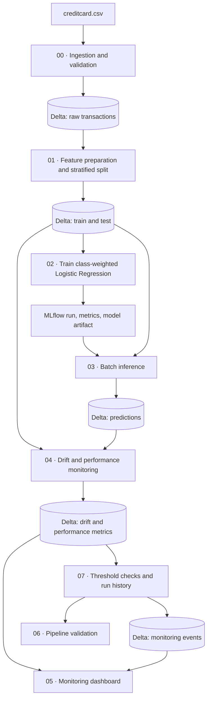

# Databricks MLOps architecture

This diagram describes the intended notebook flow in this repository. The simulated drift path is a monitoring test and must not be interpreted as real production drift.

## Main components

- **Databricks notebooks:** execute ingestion, preparation, training, inference, monitoring, visualization, validation, and alert-history tasks.
- **Delta tables:** persist input data, split datasets, predictions, drift results, evaluation metrics, and monitoring events.
- **MLflow:** track training parameters and metrics and store the model artifact used for batch scoring.
- **Monitoring:** compare feature distributions with PSI and KS statistics, evaluate metrics when labels are available, and record threshold results.

## Operational boundaries

- The inference path is batch-based; this repository does not require a paid online model-serving endpoint.
- The alert notebook records threshold results in Delta. It does not send external email or push notifications.
- The simulated drift batch validates the detector and should remain separate from actual incoming data.
- Schedule automation only after a full job run has been verified in the target workspace.
